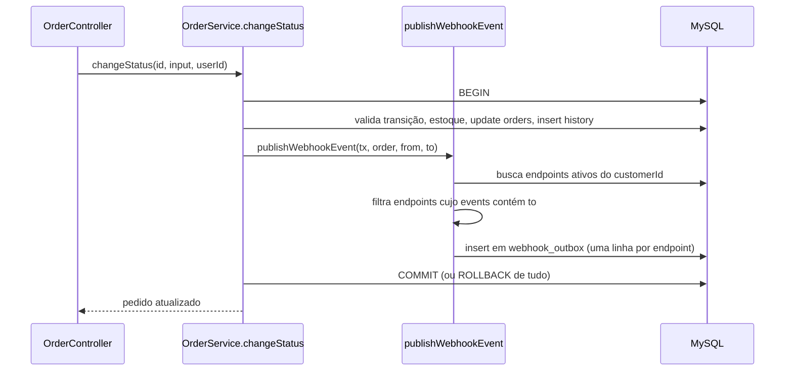
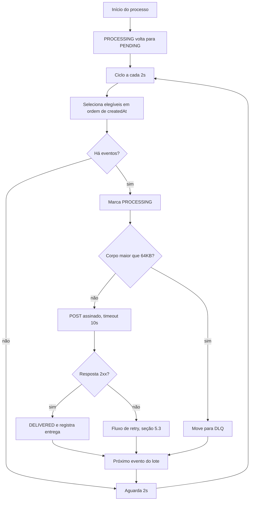

# FDD: Sistema de Webhooks de Notificação de Pedidos

| Campo | Valor |
|---|---|
| Status | Pronto para implementação, sujeito à revisão de segurança ([09:46] Sofia) |
| Data | 2026-11-17 |
| Responsáveis técnicos | Larissa (Tech Lead), Bruno (Pedidos), Diego (Plataforma) |
| Revisão de segurança | Sofia, no mínimo dois dias úteis antes do deploy |
| Documentos | [PRD](PRD.md) · [RFC](RFC.md) · [ADRs](adrs/) · [Tracker](TRACKER.md) |

Este documento descreve **como construir** a feature. O porquê de cada decisão está nos ADRs; o problema de produto, no PRD. Os identificadores entre colchetes, como `[FDD-FLUXO-01]`, correspondem às linhas do [TRACKER](TRACKER.md).

## 1. Contexto e motivação técnica

O OMS (Node.js 20, TypeScript, Express, Prisma 5 e MySQL) não tem mecanismo de notificação externa. A mudança de status de pedido acontece em `OrderService.changeStatus` (`src/modules/orders/order.service.ts`), dentro de um `prisma.$transaction`, nesta sequência:

1. lê o pedido com os itens;
2. valida a transição com `canTransition` (`src/modules/orders/order.status.ts`);
3. debita ou repõe estoque (`shouldDebitStock` / `shouldReplenishStock`);
4. atualiza `orders.status`;
5. insere em `order_status_history`.

A feature acrescenta um passo a essa transação, a inserção na outbox ([ADR-001](adrs/ADR-001-outbox-no-mysql.md)), e um processo novo que entrega os eventos ([ADR-002](adrs/ADR-002-worker-em-processo-separado.md)). A restrição central é que a transação de pedidos nunca pode esperar por uma chamada HTTP ([09:04] Bruno).

## 2. Objetivos técnicos

| ID | Objetivo |
|---|---|
| `[FDD-OBJ-01]` | Gravar o evento de mudança de status de forma atômica com a própria mudança: os dois acontecem ou nenhum acontece ([09:40] Bruno). |
| `[FDD-OBJ-02]` | Entregar ao endpoint do cliente em menos de 10 segundos no caminho feliz ([09:02] Marcos), com polling de 2 segundos ([09:10] Larissa). |
| `[FDD-OBJ-03]` | Reenviar com backoff 1 min / 5 min / 30 min / 2 h / 12 h e mover para a DLQ quando as retentativas acabarem ([09:17] Larissa). |
| `[FDD-OBJ-04]` | Permitir que o cliente verifique origem e integridade de cada entrega por HMAC-SHA256 ([09:22] Sofia). |
| `[FDD-OBJ-05]` | Seguir os padrões do projeto sem dependências novas ([09:30] Larissa). |

## 3. Escopo e exclusões

**Incluído**

- Módulo `src/modules/webhooks`: configuração de endpoints, outbox, worker, histórico de entregas, DLQ e replay.
- Evento único `order.status_changed`, disparado em toda mudança de status bem-sucedida em `changeStatus`.
- Nova entry-point `src/worker.ts` e script `npm run worker`.

**Excluído**

| ID | Item | Origem |
|---|---|---|
| `[FDD-EXC-01]` | Webhooks de entrada (cliente enviando para a plataforma) | [09:02] Marcos |
| `[FDD-EXC-02]` | E-mail ao cliente quando o webhook falha repetidamente | [09:37] Larissa |
| `[FDD-EXC-03]` | Rate limiting de saída; fica em observação | [09:39] Larissa |
| `[FDD-EXC-04]` | Dashboard ou painel visual para o cliente | [09:40] Larissa |
| `[FDD-EXC-05]` | Arquivamento das linhas entregues da outbox (por volta de 30 dias) | [09:08] Diego |
| `[FDD-EXC-06]` | Vários workers em paralelo e garantia de ordem global | [09:13] Diego, [09:13] Larissa |
| `[FDD-EXC-07]` | Itens do pedido no payload; o cliente consulta `GET /orders/:id` | [09:43] Diego |
| `[FDD-EXC-08]` | Evento na criação do pedido: só `changeStatus` publica | [09:40] Bruno |

## 4. Modelo de dados

Quatro models novos em `prisma/schema.prisma`, criados por uma migration nova em `prisma/migrations/`. Todos usam `id String @id @default(uuid()) @db.Char(36)`, como o resto do schema ([09:51] Larissa).

```prisma
enum WebhookOutboxStatus {
  PENDING
  PROCESSING
  FAILED
  DELIVERED
}

model WebhookEndpoint {
  id                      String    @id @default(uuid()) @db.Char(36)
  customerId              String    @db.Char(36)
  url                     String    @db.VarChar(2048)
  secret                  String    @db.VarChar(128)
  previousSecret          String?   @db.VarChar(128)
  previousSecretExpiresAt DateTime?
  events                  Json      // lista de OrderStatus assinados
  active                  Boolean   @default(true)
  createdAt               DateTime  @default(now())
  updatedAt               DateTime  @updatedAt

  customer    Customer            @relation(fields: [customerId], references: [id], onDelete: Cascade)
  outbox      WebhookOutbox[]
  deliveries  WebhookDelivery[]
  deadLetters WebhookDeadLetter[]

  @@index([customerId])
  @@map("webhook_endpoints")
}

model WebhookOutbox {
  id            String              @id @db.Char(36) // = event_id = X-Event-Id
  webhookId     String              @db.Char(36)
  orderId       String              @db.Char(36)     // sem FK: o payload é snapshot
  eventType     String              @db.VarChar(64)
  payload       Json
  status        WebhookOutboxStatus @default(PENDING)
  attempts      Int                 @default(0)       // envios já realizados
  nextAttemptAt DateTime            @default(now())
  lastErrorCode String?             @db.VarChar(64)
  deliveredAt   DateTime?
  createdAt     DateTime            @default(now())
  updatedAt     DateTime            @updatedAt

  webhook WebhookEndpoint @relation(fields: [webhookId], references: [id], onDelete: Cascade)

  @@index([status])
  @@index([createdAt])
  @@index([status, nextAttemptAt])
  @@index([webhookId, orderId])
  @@map("webhook_outbox")
}

model WebhookDelivery {
  id             String   @id @default(uuid()) @db.Char(36)
  webhookId      String   @db.Char(36)
  eventId        String   @db.Char(36)
  attempt        Int
  success        Boolean
  payload        Json
  responseStatus Int?
  durationMs     Int
  errorCode      String?  @db.VarChar(64)
  createdAt      DateTime @default(now())

  webhook WebhookEndpoint @relation(fields: [webhookId], references: [id], onDelete: Cascade)

  @@index([webhookId, createdAt])
  @@index([eventId])
  @@map("webhook_deliveries")
}

model WebhookDeadLetter {
  id           String    @id @default(uuid()) @db.Char(36)
  eventId      String    @unique @db.Char(36)
  webhookId    String    @db.Char(36)
  orderId      String    @db.Char(36)
  eventType    String    @db.VarChar(64)
  payload      Json
  reason       String    @db.VarChar(500)
  errorCode    String    @db.VarChar(64)
  attempts     Int
  failedAt     DateTime
  replayedAt   DateTime?
  replayedById String?   @db.Char(36)
  createdAt    DateTime  @default(now())

  webhook WebhookEndpoint @relation(fields: [webhookId], references: [id], onDelete: Cascade)

  @@index([webhookId])
  @@map("webhook_dead_letter")
}
```

O model `Customer` ganha a relação inversa `webhooks WebhookEndpoint[]`.

| ID | Regra do modelo | Origem |
|---|---|---|
| `[FDD-DADOS-01]` | `webhook_endpoints` guarda URL, secret, `customer_id` e estado ativo. | [09:21] Bruno, [09:21] Sofia |
| `[FDD-DADOS-02]` | `webhook_outbox` tem índice em `status` e em `created_at`. Os outros dois índices servem à consulta do worker (seção 5.2). | [09:08] Diego |
| `[FDD-DADOS-03]` | Os status da outbox são os quatro listados por Diego: `PENDING`, `PROCESSING`, `FAILED` (aguardando retentativa) e `DELIVERED`. | [09:08] Diego |
| `[FDD-DADOS-04]` | O `id` da outbox é o `event_id`, gerado com `uuid` v4 na inserção (pacote `uuid` já é dependência e é usado em `src/middlewares/request-logger.middleware.ts`). | [09:25] Diego |
| `[FDD-DADOS-05]` | `webhook_dead_letter` guarda payload, motivo e timestamp da falha. | [09:18] Diego |
| `[FDD-DADOS-06]` | `webhook_deliveries` registra cada tentativa (sucesso/falha, payload, status de resposta, duração) para alimentar o histórico. | [09:34] Marcos |
| `[FDD-DADOS-07]` | A outbox não tem FK para `orders`, porque o payload é snapshot; excluir um pedido não afeta eventos já gravados. | [09:52] Larissa |

## 5. Fluxos detalhados

### 5.1 Criação do evento na outbox



| ID | Passo |
|---|---|
| `[FDD-FLUXO-01]` | `changeStatus` chama `publishWebhookEvent(tx, order, from, to)` depois de inserir em `order_status_history`, com o mesmo `tx` ([09:41] Bruno). |
| `[FDD-FLUXO-02]` | A função busca os endpoints `active = true` do `order.customerId` e mantém só os que têm `to` na lista `events`. Sem endpoint elegível, não insere nada ([09:34] Bruno). |
| `[FDD-FLUXO-03]` | Para cada endpoint elegível, insere uma linha `PENDING` com `attempts = 0`, `nextAttemptAt = now()` e o payload completo já renderizado ([09:52] Larissa). Cada endpoint tem secret, filtro e histórico próprios ([09:21] Sofia, [09:33] Bruno), por isso cada endpoint gera a sua linha, com o seu `event_id`. |
| `[FDD-FLUXO-04]` | Qualquer erro na inserção propaga e faz rollback da mudança de status inteira ([09:40] Bruno, [09:41] Diego). |
| `[FDD-FLUXO-05]` | `create` (pedido novo em `PENDING`) não publica evento: o ponto de integração definido é `changeStatus` ([09:40] Bruno). |

### 5.2 Processamento pelo worker

O worker roda em `src/worker.ts`, como processo próprio, e delega o laço para `src/modules/webhooks/webhook.worker.ts` ([09:11] Larissa, [09:28] Bruno).



| ID | Passo |
|---|---|
| `[FDD-FLUXO-06]` | Na inicialização, o worker devolve para `PENDING` as linhas que ficaram em `PROCESSING` (interrupção no meio de um envio). Como existe um único worker, isso é seguro e pode gerar reenvio, o que a garantia at-least-once admite ([09:12] Diego, [09:24] Diego). |
| `[FDD-FLUXO-07]` | A cada 2 segundos (`WEBHOOK_POLL_INTERVAL_MS`, padrão `2000`), o worker seleciona linhas com `status IN (PENDING, FAILED)` e `nextAttemptAt <= now()`, em ordem de `createdAt`, num lote pequeno (`WEBHOOK_BATCH_SIZE`) ([09:08] Diego, [09:09] Diego). O próximo ciclo só começa depois que o atual termina, para não sobrepor envios. |
| `[FDD-FLUXO-08]` | **Ordem por pedido:** uma linha só é elegível se não houver, para o mesmo `webhookId` e `orderId`, outra linha mais antiga ainda não entregue. Assim, um evento em espera de retry segura os eventos seguintes daquele pedido para aquele endpoint, mantendo a ordem por `order_id` assumida na reunião ([09:12] Diego, [09:13] Larissa). Quando o evento mais antigo vai para a DLQ, ele sai da outbox e libera os seguintes. |
| `[FDD-FLUXO-09]` | Os eventos do lote são processados em sequência: marca `PROCESSING`, serializa o payload uma única vez e verifica o tamanho em bytes. |
| `[FDD-FLUXO-10]` | Corpo acima de 65.536 bytes não é enviado nem truncado: vai direto para a DLQ com `WEBHOOK_PAYLOAD_TOO_LARGE`, sem retry, porque o snapshot não muda ([09:23] Sofia, [09:24] Larissa). A verificação fica no worker para que um evento grande nunca bloqueie a mudança de status. |
| `[FDD-FLUXO-11]` | O envio usa o `fetch` nativo do Node 20 com `AbortSignal.timeout(10000)` (`WEBHOOK_HTTP_TIMEOUT_MS`) e `redirect: 'manual'` ([09:42] Diego). |
| `[FDD-FLUXO-12]` | Resposta 2xx: a linha vai para `DELIVERED` com `deliveredAt`, `attempts` é incrementado e uma linha de sucesso entra em `webhook_deliveries`. |
| `[FDD-FLUXO-13]` | Qualquer outra situação é falha: resposta fora de 2xx (incluindo 3xx), timeout ou erro de rede. Uma linha de falha entra em `webhook_deliveries` e o evento segue para a seção 5.3. |
| `[FDD-FLUXO-14]` | Ao receber `SIGINT` ou `SIGTERM`, o worker termina o evento em curso, não inicia novo ciclo e chama `prisma.$disconnect()`, no mesmo modelo de `src/server.ts`. |

### 5.3 Retry

Constante do módulo: `RETRY_DELAYS_MS = [1 min, 5 min, 30 min, 2 h, 12 h]` ([09:17] Larissa).

| Envio | Quando acontece | Se falhar |
|---|---|---|
| 1 (inicial) | primeiro ciclo após o commit | `FAILED`, próxima tentativa em +1 min |
| 2 (retentativa 1) | +1 min | `FAILED`, +5 min |
| 3 (retentativa 2) | +5 min | `FAILED`, +30 min |
| 4 (retentativa 3) | +30 min | `FAILED`, +2 h |
| 5 (retentativa 4) | +2 h | `FAILED`, +12 h |
| 6 (retentativa 5) | +12 h | move para a DLQ |

| ID | Regra |
|---|---|
| `[FDD-RETRY-01]` | Depois de cada falha, `attempts` passa a `n`. Se `n <= 5`, a linha fica `FAILED` com `nextAttemptAt = now() + RETRY_DELAYS_MS[n - 1]` e `lastErrorCode` preenchido. Se `n = 6`, segue para a seção 5.4. |
| `[FDD-RETRY-02]` | Entre a primeira falha e a última retentativa passam 14 h 36 min, a janela de "quase 15 horas" acordada ([09:17] Diego, [09:17] Marcos). |
| `[FDD-RETRY-03]` | O payload, o `X-Event-Id` e o `X-Webhook-Id` são os mesmos em todas as retentativas; `X-Timestamp` e `X-Signature` são recalculados a cada envio ([09:25] Diego, [09:44] Diego). |

### 5.4 DLQ e replay

| ID | Passo |
|---|---|
| `[FDD-DLQ-01]` | Esgotadas as retentativas (ou com `WEBHOOK_PAYLOAD_TOO_LARGE`), numa única transação o worker faz upsert em `webhook_dead_letter` por `eventId` (payload, `reason`, `errorCode`, `attempts`, `failedAt`, `replayedAt = null`) e remove a linha da outbox ([09:18] Diego). |
| `[FDD-DLQ-02]` | O replay é feito em `POST /api/v1/admin/webhooks/dead-letter/:id/replay`, com `requireRole('ADMIN')` ([09:18] Diego, [09:36] Sofia, [09:36] Larissa). |
| `[FDD-DLQ-03]` | Numa transação, o replay insere na outbox uma linha `PENDING` com `id = eventId` (o mesmo `X-Event-Id`), o mesmo payload, `attempts = 0` e `nextAttemptAt = now()`, e grava `replayedAt` e `replayedById` na DLQ ([09:18] Diego, [09:25] Diego). |
| `[FDD-DLQ-04]` | O replay emite o log de auditoria `webhook_dead_letter_replayed` com `userId`, `deadLetterId`, `eventId` e `webhookId` ([09:36] Sofia). |
| `[FDD-DLQ-05]` | Um item já reprocessado (`replayedAt` preenchido) não pode ser reprocessado de novo: `409 WEBHOOK_DEAD_LETTER_ALREADY_REPLAYED`. Se o evento falhar outra vez, o upsert de `[FDD-DLQ-01]` limpa `replayedAt` e o item volta a ser reprocessável. |

### 5.5 Rotação de secret

| ID | Passo |
|---|---|
| `[FDD-ROT-01]` | `POST /api/v1/webhooks/:id/rotate-secret` gera uma nova secret, move a atual para `previousSecret` e define `previousSecretExpiresAt = now() + 24 h` ([09:21] Sofia). |
| `[FDD-ROT-02]` | Enquanto `previousSecretExpiresAt > now()`, o worker assina com as duas secrets (seção 6.2). Depois disso, assina só com a atual. |
| `[FDD-ROT-03]` | Uma nova rotação durante a janela substitui `previousSecret` pela secret que estava ativa; a secret mais antiga deixa de valer na hora. A resposta da rotação informa `previousSecretExpiresAt` para que isso fique explícito. |
| `[FDD-ROT-04]` | A rotação emite o log `webhook_secret_rotated` com `userId` e `webhookId`, sem o valor da secret. |

## 6. Contrato de entrega ao cliente

### 6.1 Payload do evento

`[FDD-CONTRATO-01]` O corpo é JSON enxuto, sem itens do pedido ([09:43] Diego, [09:44] Bruno).

```json
{
  "event_id": "5b0f8f7e-2a64-4b8e-9d0a-1f3c9e2b7a41",
  "event_type": "order.status_changed",
  "timestamp": "2026-11-20T14:32:05.123Z",
  "order_id": "a3c1e9d2-6f4b-4a77-8b3e-0d9c2f1e5a60",
  "order_number": "ORD-000123",
  "from_status": "PROCESSING",
  "to_status": "SHIPPED",
  "customer_id": "c7d2b1a0-9e8f-4c3d-b2a1-0f9e8d7c6b5a",
  "total_cents": 15990
}
```

| Campo | Origem do valor |
|---|---|
| `event_id` | `id` da linha da outbox |
| `event_type` | constante `order.status_changed` |
| `timestamp` | ISO 8601 do momento da inserção na outbox, ou seja, da mudança de status |
| `order_id`, `order_number`, `customer_id`, `total_cents` | `Order.id`, `Order.orderNumber`, `Order.customerId`, `Order.totalCents` (`prisma/schema.prisma`) |
| `from_status`, `to_status` | `from` e `to` de `changeStatus`, valores de `OrderStatus` |

### 6.2 Assinatura HMAC

`[FDD-CONTRATO-02]` A assinatura é `hex(HMAC-SHA256(secret, corpo))`, calculada sobre os bytes exatos do corpo enviado, com o módulo `crypto` do Node ([09:20] Sofia, [09:22] Sofia).

- Fora da janela de rotação: `X-Signature: <hmac_secret_atual>`.
- Dentro da janela de rotação: `X-Signature: <hmac_secret_atual>,<hmac_secret_anterior>`. O cliente aceita a requisição se qualquer um dos valores conferir com a secret que ele tem ([09:21] Sofia).
- A secret é gerada com `crypto.randomBytes(32)` em hexadecimal. Ela é devolvida apenas na criação e na rotação, e nunca aparece em listagens nem em logs ([09:31] Marcos, [09:46] Sofia).

Verificação de referência para o portal do desenvolvedor:

```ts
import { createHmac, timingSafeEqual } from 'node:crypto';

function isValid(rawBody: Buffer, header: string, secret: string): boolean {
  const expected = createHmac('sha256', secret).update(rawBody).digest('hex');
  return header.split(',').some((sig) => {
    const received = Buffer.from(sig.trim(), 'hex');
    const wanted = Buffer.from(expected, 'hex');
    return received.length === wanted.length && timingSafeEqual(received, wanted);
  });
}
```

### 6.3 Headers

`[FDD-CONTRATO-03]` ([09:44] Diego, [09:44] Sofia, [09:45] Diego)

| Header | Valor |
|---|---|
| `Content-Type` | `application/json` |
| `X-Event-Id` | UUID do evento; o mesmo em retentativas e replay |
| `X-Webhook-Id` | `id` do endpoint cadastrado, para clientes com vários cadastros |
| `X-Timestamp` | ISO 8601 do momento do envio, para o cliente detectar replay attack se quiser |
| `X-Signature` | HMAC-SHA256 do corpo (seção 6.2) |

### 6.4 Semântica da resposta do cliente

`[FDD-CONTRATO-04]` A plataforma considera entregue qualquer resposta 2xx recebida em até 10 segundos. O corpo da resposta é ignorado. Redirecionamentos não são seguidos, para que o único destino seja a URL `https` cadastrada ([09:23] Sofia). O cliente deve deduplicar por `X-Event-Id` ([09:25] Diego).

## 7. Contratos públicos

Todos os endpoints ficam sob o prefixo `/api/v1` que `src/app.ts` já aplica e exigem `Authorization: Bearer <JWT>` via `authenticate`. Erros seguem o formato atual de `src/middlewares/error.middleware.ts`: `{ "error": { "code", "message", "details?" } }`. O `customerId` vai no corpo ou na query, e não vem do JWT, porque o token identifica um usuário operador ([09:32] Bruno, [09:32] Larissa).

Permissões: qualquer usuário autenticado (`ADMIN` ou `OPERATOR`) usa os endpoints de configuração; o replay exige `ADMIN` ([09:36] Marcos, [09:37] Sofia, [09:36] Sofia).

### 7.1 `POST /api/v1/webhooks`: cadastrar webhook `[FDD-CONTRATO-05]`

Origem: [09:31] Marcos.

Request:

```json
{
  "customerId": "c7d2b1a0-9e8f-4c3d-b2a1-0f9e8d7c6b5a",
  "url": "https://hooks.atlascomercial.com.br/oms",
  "events": ["SHIPPED", "DELIVERED"]
}
```

Response `201 Created`:

```json
{
  "id": "e1f2a3b4-c5d6-4e7f-8a9b-0c1d2e3f4a5b",
  "customerId": "c7d2b1a0-9e8f-4c3d-b2a1-0f9e8d7c6b5a",
  "url": "https://hooks.atlascomercial.com.br/oms",
  "events": ["SHIPPED", "DELIVERED"],
  "active": true,
  "secret": "9f2c4e6a8b0d1f3e5a7c9b2d4f6e8a0c1b3d5f7e9a2c4e6b8d0f1a3c5e7b9d2f",
  "createdAt": "2026-11-20T14:00:00.000Z",
  "updatedAt": "2026-11-20T14:00:00.000Z"
}
```

| Status | Quando |
|---|---|
| `201` | Criado; única resposta (junto com a rotação) que contém `secret` |
| `400 VALIDATION_ERROR` | Campo ausente ou de tipo errado (`validate` + Zod) |
| `400 WEBHOOK_INVALID_URL` | URL malformada ou fora de `https` |
| `400 WEBHOOK_INVALID_EVENTS` | `events` vazio |
| `401 UNAUTHORIZED` | Sem token ou token inválido |
| `404 NOT_FOUND` | `customerId` inexistente (`NotFoundError('Customer')`, como em `CustomerService`) |

### 7.2 `GET /api/v1/webhooks?customerId=...`: listar webhooks de um cliente `[FDD-CONTRATO-06]`

Origem: [09:33] Bruno. Query: `customerId` (obrigatório), `page` e `pageSize`, como em `listOrdersQuerySchema`.

Response `200 OK`, no formato de `paginated()` (`src/shared/http/response.ts`), sem `secret`:

```json
{
  "data": [
    {
      "id": "e1f2a3b4-c5d6-4e7f-8a9b-0c1d2e3f4a5b",
      "customerId": "c7d2b1a0-9e8f-4c3d-b2a1-0f9e8d7c6b5a",
      "url": "https://hooks.atlascomercial.com.br/oms",
      "events": ["SHIPPED", "DELIVERED"],
      "active": true,
      "secretRotationEndsAt": null,
      "createdAt": "2026-11-20T14:00:00.000Z",
      "updatedAt": "2026-11-20T14:00:00.000Z"
    }
  ],
  "pagination": { "page": 1, "pageSize": 20, "total": 1, "totalPages": 1 }
}
```

`secretRotationEndsAt` expõe `previousSecretExpiresAt`. Status: `200`, `400 VALIDATION_ERROR` (sem `customerId`), `401 UNAUTHORIZED`.

### 7.3 `PATCH /api/v1/webhooks/:id`: editar webhook `[FDD-CONTRATO-07]`

Origem: [09:33] Bruno. Campos opcionais: `url`, `events`, `active`.

Request:

```json
{ "events": ["PAID", "SHIPPED", "DELIVERED"], "active": true }
```

Response `200 OK`: mesmo corpo de um item da listagem, com os valores atualizados.

Status: `200`, `400 VALIDATION_ERROR`, `400 WEBHOOK_INVALID_URL`, `400 WEBHOOK_INVALID_EVENTS`, `401 UNAUTHORIZED`, `404 WEBHOOK_NOT_FOUND`.

Mudanças de `events` e `active` valem para as próximas mudanças de status. Eventos já gravados na outbox seguem o fluxo normal, porque o filtro é aplicado na inserção ([09:34] Bruno).

### 7.4 `DELETE /api/v1/webhooks/:id`: remover webhook `[FDD-CONTRATO-08]`

Origem: [09:33] Bruno. Sem corpo.

Response `204 No Content`. Remove o endpoint e, por `onDelete: Cascade`, as linhas de outbox, entregas e DLQ ligadas a ele.

Status: `204`, `401 UNAUTHORIZED`, `404 WEBHOOK_NOT_FOUND`.

### 7.5 `POST /api/v1/webhooks/:id/rotate-secret`: rotacionar secret `[FDD-CONTRATO-09]`

Origem: [09:21] Sofia, que pediu um "endpoint pro cliente conseguir pedir nova secret pela API". O path segue o padrão de sub-recurso de `PATCH /orders/:id/status`; a reunião não nomeou o path.

Request: corpo vazio `{}`.

Response `200 OK`:

```json
{
  "id": "e1f2a3b4-c5d6-4e7f-8a9b-0c1d2e3f4a5b",
  "secret": "1a3c5e7b9d2f4a6c8e0b2d4f6a8c0e2b4d6f8a1c3e5b7d9f2a4c6e8b0d1f3a5c",
  "previousSecretExpiresAt": "2026-11-21T14:00:00.000Z"
}
```

Status: `200`, `401 UNAUTHORIZED`, `404 WEBHOOK_NOT_FOUND`.

### 7.6 `GET /api/v1/webhooks/:id/deliveries`: histórico de entregas `[FDD-CONTRATO-10]`

Origem: [09:34] Marcos. Retorna as **últimas 100** tentativas, da mais recente para a mais antiga.

Response `200 OK`:

```json
{
  "data": [
    {
      "id": "0a1b2c3d-4e5f-4a6b-8c7d-9e0f1a2b3c4d",
      "eventId": "5b0f8f7e-2a64-4b8e-9d0a-1f3c9e2b7a41",
      "attempt": 2,
      "success": true,
      "responseStatus": 200,
      "durationMs": 184,
      "errorCode": null,
      "payload": { "event_id": "5b0f8f7e-2a64-4b8e-9d0a-1f3c9e2b7a41", "event_type": "order.status_changed", "to_status": "SHIPPED" },
      "createdAt": "2026-11-20T14:33:06.000Z"
    },
    {
      "id": "9d8c7b6a-5f4e-4d3c-2b1a-0f9e8d7c6b5a",
      "eventId": "5b0f8f7e-2a64-4b8e-9d0a-1f3c9e2b7a41",
      "attempt": 1,
      "success": false,
      "responseStatus": 503,
      "durationMs": 92,
      "errorCode": "WEBHOOK_DELIVERY_FAILED",
      "payload": { "event_id": "5b0f8f7e-2a64-4b8e-9d0a-1f3c9e2b7a41", "event_type": "order.status_changed", "to_status": "SHIPPED" },
      "createdAt": "2026-11-20T14:32:06.000Z"
    }
  ]
}
```

O `payload` aparece resumido no exemplo; na resposta real ele vem completo, como na seção 6.1.

Status: `200`, `401 UNAUTHORIZED`, `404 WEBHOOK_NOT_FOUND`.

### 7.7 `POST /api/v1/admin/webhooks/dead-letter/:id/replay`: reprocessar DLQ `[FDD-CONTRATO-11]`

Origem: [09:18] Diego, [09:36] Sofia. Exige `requireRole('ADMIN')`.

Request: corpo vazio `{}`.

Response `202 Accepted`:

```json
{
  "deadLetterId": "4f3e2d1c-0b9a-4876-9543-210fedcba987",
  "eventId": "5b0f8f7e-2a64-4b8e-9d0a-1f3c9e2b7a41",
  "webhookId": "e1f2a3b4-c5d6-4e7f-8a9b-0c1d2e3f4a5b",
  "status": "PENDING",
  "replayedAt": "2026-11-21T09:10:00.000Z",
  "replayedById": "b2c3d4e5-f6a7-4b8c-9d0e-1f2a3b4c5d6e"
}
```

`202` indica que o evento voltou para a fila; a entrega acontece no próximo ciclo do worker.

| Status | Quando |
|---|---|
| `202` | Evento recolocado na outbox |
| `401 UNAUTHORIZED` | Sem token |
| `403 FORBIDDEN` | Usuário sem role `ADMIN` (`requireRole`) |
| `404 WEBHOOK_DEAD_LETTER_NOT_FOUND` | `id` inexistente na DLQ |
| `409 WEBHOOK_DEAD_LETTER_ALREADY_REPLAYED` | Item já reprocessado e ainda não falhou de novo |

## 8. Matriz de erros

Erros da API são subclasses de `AppError` e passam pelo `errorMiddleware` sem alteração ([09:28] Bruno, [09:29] Bruno). Erros do worker não viram resposta HTTP: são gravados em `webhook_deliveries.errorCode`, `webhook_outbox.lastErrorCode` e `webhook_dead_letter.errorCode`.

| ID | Código | HTTP | Onde | Condição | Comportamento |
|---|---|---|---|---|---|
| `[FDD-ERR-01]` | `WEBHOOK_NOT_FOUND` | 404 | API | `:id` de webhook inexistente | Resposta de erro; nada é alterado |
| `[FDD-ERR-02]` | `WEBHOOK_INVALID_URL` | 400 | API | URL malformada ou sem `https` | Recusa o cadastro ou a edição ([09:23] Sofia) |
| `[FDD-ERR-03]` | `WEBHOOK_INVALID_EVENTS` | 400 | API | Lista `events` vazia | Recusa o cadastro ou a edição |
| `[FDD-ERR-04]` | `WEBHOOK_DEAD_LETTER_NOT_FOUND` | 404 | API | `:id` inexistente na DLQ | Resposta de erro |
| `[FDD-ERR-05]` | `WEBHOOK_DEAD_LETTER_ALREADY_REPLAYED` | 409 | API | Replay de item com `replayedAt` preenchido | Resposta de erro; evita duplicar o evento na outbox |
| `[FDD-ERR-06]` | `WEBHOOK_DELIVERY_TIMEOUT` | — | Worker | Sem resposta em 10 s | Falha, entra no retry ([09:42] Diego) |
| `[FDD-ERR-07]` | `WEBHOOK_DELIVERY_FAILED` | — | Worker | Resposta fora de 2xx, ou erro de rede, DNS ou TLS | Falha, entra no retry |
| `[FDD-ERR-08]` | `WEBHOOK_PAYLOAD_TOO_LARGE` | — | Worker | Corpo acima de 64 KB | Não envia; vai direto para a DLQ ([09:24] Larissa) |

Códigos existentes reutilizados sem mudança: `VALIDATION_ERROR` (400, formato do corpo, via `validate`), `UNAUTHORIZED` (401, `authenticate`), `FORBIDDEN` (403, `requireRole`) e `NOT_FOUND` (404, cliente inexistente).

`WEBHOOK_SECRET_REQUIRED`, citado por Bruno como exemplo de código ([09:28] Bruno), não se aplica a este desenho: a secret é gerada pela plataforma e nunca é enviada pelo cliente ([09:31] Marcos).

## 9. Estratégias de resiliência

| ID | Estratégia | Valor | Origem |
|---|---|---|---|
| `[FDD-RES-01]` | Timeout por envio | 10 s, via `AbortSignal.timeout` | [09:42] Diego |
| `[FDD-RES-02]` | Retentativas | 5, depois do envio inicial | [09:17] Larissa |
| `[FDD-RES-03]` | Backoff | 1 min, 5 min, 30 min, 2 h, 12 h | [09:17] Diego |
| `[FDD-RES-04]` | Fallback de falha permanente | DLQ em `webhook_dead_letter` com replay manual por `ADMIN` | [09:18] Diego |
| `[FDD-RES-05]` | Isolamento da transação de pedidos | Nenhuma chamada HTTP dentro de `changeStatus` | [09:04] Bruno |
| `[FDD-RES-06]` | Recuperação após queda do worker | `PROCESSING` volta para `PENDING` na inicialização | [09:24] Diego |
| `[FDD-RES-07]` | Independência entre API e worker | Processos separados; restart de um não afeta o outro | [09:11] Diego |
| `[FDD-RES-08]` | Limite de payload | 64 KB, erro sem truncar | [09:24] Diego, [09:24] Larissa |
| `[FDD-RES-09]` | Ordem por pedido | Evento mais antigo não entregue segura os seguintes do mesmo pedido e endpoint | [09:13] Larissa |

Não há circuit breaker nem rate limiting de saída nesta fase ([09:39] Larissa). Se o worker parar, os eventos continuam gravados na outbox e são entregues quando ele voltar, sujeitos ao backoff.

## 10. Observabilidade

O projeto não tem stack de métricas nem de tracing. A feature usa o que já existe, o logger Pino de `src/shared/logger/index.ts` e o banco, sem introduzir ferramenta nova ([09:29] Bruno).

### 10.1 Logs

O worker usa `logger.child({ component: 'webhook-worker' })`. Os nomes de evento seguem o padrão `snake_case` de `server_started` e `http_request`.

| ID | Evento | Nível | Campos |
|---|---|---|---|
| `[FDD-OBS-01]` | `webhook_worker_started` / `webhook_worker_stopped` | info | `pollIntervalMs`, `batchSize`, `recoveredProcessing` |
| `[FDD-OBS-02]` | `webhook_delivery_succeeded` | info | `eventId`, `webhookId`, `orderId`, `customerId`, `attempt`, `responseStatus`, `durationMs`, `latencyMs` |
| `[FDD-OBS-03]` | `webhook_delivery_failed` | warn | os mesmos, mais `errorCode` e `nextAttemptAt` |
| `[FDD-OBS-04]` | `webhook_dead_lettered` | error | `eventId`, `webhookId`, `orderId`, `errorCode`, `attempts` |
| `[FDD-OBS-05]` | `webhook_dead_letter_replayed` | info | `userId`, `deadLetterId`, `eventId`, `webhookId` (auditoria pedida em [09:36] Sofia) |
| `[FDD-OBS-06]` | `webhook_secret_rotated` | info | `userId`, `webhookId` |

`[FDD-OBS-07]` A lista `redactPaths` de `src/shared/logger/index.ts` ganha `*.secret` e `*.previousSecret`, para que nenhuma secret apareça em log (o caso de vazamento citado em [09:22] Diego).

### 10.2 Métricas

As métricas são derivadas dos campos dos logs acima e de consultas às tabelas novas. Exportá-las para uma ferramenta de métricas não faz parte desta entrega.

| ID | Métrica | Como obter | Uso |
|---|---|---|---|
| `[FDD-OBS-08]` | Latência de entrega (`latencyMs`: `createdAt` da outbox até o 2xx) | log `webhook_delivery_succeeded` | Verificar a meta de menos de 10 s ([09:02] Marcos) |
| `[FDD-OBS-09]` | Duração da chamada HTTP (`durationMs`) | `webhook_deliveries` e logs | Identificar clientes lentos perto do timeout |
| `[FDD-OBS-10]` | Backlog: linhas `PENDING` e `FAILED` | `COUNT` em `webhook_outbox` por `status` | Detectar worker parado ou atrasado |
| `[FDD-OBS-11]` | Taxa de falha e volume de retentativas por endpoint | `webhook_deliveries` | Acompanhar a volumetria por cliente, insumo da questão de rate limit ([09:39] Diego) |
| `[FDD-OBS-12]` | Itens na DLQ sem replay | `COUNT` em `webhook_dead_letter` com `replayedAt IS NULL` | Acionar o replay manual |

### 10.3 Tracing

`[FDD-OBS-13]` O rastreio de um evento usa o `event_id` como chave de correlação. O mesmo valor está na linha da outbox, em cada linha de `webhook_deliveries`, na DLQ, em todos os logs do worker e no header `X-Event-Id` recebido pelo cliente, de modo que suporte e cliente falam do mesmo identificador. Para ligar o evento à requisição que mudou o status, usa-se o `orderId`, presente tanto no log `http_request` da API (que já carrega o `requestId` de `src/middlewares/request-logger.middleware.ts`) quanto nos logs do worker. Tracing distribuído com ferramenta dedicada fica fora desta entrega.

## 11. Integração com o sistema existente

Esta seção descreve, arquivo por arquivo, o que o PR de implementação faz. Este pacote documental não altera nenhum desses arquivos.

| ID | Arquivo | Integração |
|---|---|---|
| `[FDD-INT-01]` | `src/modules/orders/order.service.ts` | `changeStatus` chama `publishWebhookEvent` dentro do `$transaction`, depois de `tx.orderStatusHistory.create` e antes da releitura `refreshed`. `create` e `delete` não mudam. |
| `[FDD-INT-02]` | `src/modules/orders/order.status.ts` | Sem alteração. Toda transição aceita por `canTransition` gera evento, inclusive para `CANCELLED`. O filtro `events` aceita os valores do enum `OrderStatus`. |
| `[FDD-INT-03]` | `src/shared/errors/app-error.ts` e `src/shared/errors/http-errors.ts` | Os erros do módulo ficam em `src/modules/webhooks/webhook.errors.ts`. `WebhookNotFoundError` e `WebhookDeadLetterNotFoundError` estendem `AppError` com status 404, porque `NotFoundError` fixa o código `NOT_FOUND`. `WebhookInvalidUrlError` e `WebhookInvalidEventsError` estendem `BadRequestError`, e `WebhookDeadLetterAlreadyReplayedError` estende `ConflictError`, as duas classes que aceitam código customizado. |
| `[FDD-INT-04]` | `src/middlewares/error.middleware.ts` | Sem alteração: o ramo `err instanceof AppError` já serializa os novos erros ([09:29] Bruno). |
| `[FDD-INT-05]` | `src/middlewares/auth.middleware.ts` | `authenticate` em todos os routers novos; `requireRole('ADMIN')` no router de replay ([09:36] Larissa). |
| `[FDD-INT-06]` | `src/middlewares/validate.middleware.ts` | `webhook.schemas.ts` define `createWebhookSchema`, `updateWebhookSchema`, `listWebhooksQuerySchema` e `webhookIdParamSchema`, usados com `validate({ body, query, params })` como em `order.routes.ts`. A regra de `https` fica num schema Zod (`webhookUrlSchema`) que o service aplica para lançar `WEBHOOK_INVALID_URL`. |
| `[FDD-INT-07]` | `src/routes/index.ts` | `Controllers` ganha `webhooks` e `adminWebhooks`; `buildApiRouter` registra `router.use('/webhooks', ...)` e `router.use('/admin/webhooks', ...)`. |
| `[FDD-INT-08]` | `src/app.ts` | `buildControllers` instancia `WebhookRepository`, `WebhookService` e `WebhookController`, no mesmo padrão dos outros módulos. |
| `[FDD-INT-09]` | `src/server.ts` | Modelo para `src/worker.ts`: `bootstrap()`, tratamento de `SIGINT`/`SIGTERM`, `prisma.$disconnect()` e `logger.fatal` em falha de bootstrap. |
| `[FDD-INT-10]` | `src/config/database.ts` | O worker cria a própria instância com `createPrismaClient()`, na mesma `DATABASE_URL` ([09:30] Bruno). |
| `[FDD-INT-11]` | `src/config/env.ts` | `envSchema` ganha `WEBHOOK_POLL_INTERVAL_MS` (padrão `2000`), `WEBHOOK_HTTP_TIMEOUT_MS` (padrão `10000`) e `WEBHOOK_BATCH_SIZE`. |
| `[FDD-INT-12]` | `src/shared/logger/index.ts` | Inclusão de `*.secret` e `*.previousSecret` em `redactPaths`; o worker usa `logger.child`. |
| `[FDD-INT-13]` | `src/shared/http/response.ts` | `paginated()` na listagem de webhooks. |
| `[FDD-INT-14]` | `prisma/schema.prisma` | Os quatro models e o enum da seção 4, mais a relação `webhooks` em `Customer`; migration nova em `prisma/migrations/`. |
| `[FDD-INT-15]` | `package.json` | Script `"worker": "tsx --env-file=.env src/worker.ts"` para desenvolvimento e `"start:worker": "node --env-file=.env dist/worker.js"` para produção, no padrão de `dev`/`start`. `tsconfig.build.json` já compila `src/**/*.ts`, então `src/worker.ts` entra no build sem mudança. |
| `[FDD-INT-16]` | `tests/setup.ts` e `tests/helpers/factories.ts` | O `beforeEach` passa a limpar as tabelas de webhook antes de `customer.deleteMany()`, e as factories ganham `createTestWebhook`. |

Trecho de referência para `[FDD-INT-01]`:

```ts
await tx.order.update({ where: { id }, data: { status: to } });
await tx.orderStatusHistory.create({
  data: { orderId: id, fromStatus: from, toStatus: to, changedById: userId, reason: input.reason ?? null },
});

await publishWebhookEvent(tx, order, from, to);
```

Assinatura em `src/modules/webhooks/webhook.publisher.ts` (arquivo novo):

```ts
export async function publishWebhookEvent(
  tx: Prisma.TransactionClient,
  order: Pick<Order, 'id' | 'orderNumber' | 'customerId' | 'totalCents'>,
  fromStatus: OrderStatus,
  toStatus: OrderStatus,
): Promise<number>; // quantidade de eventos gravados
```

Estrutura do módulo, no padrão de `src/modules/orders/` ([09:27] Bruno, [09:28] Bruno). Todos os arquivos abaixo são **novos**, criados no PR de implementação:

```text
src/modules/webhooks/
  webhook.controller.ts       CRUD, rotação, histórico
  webhook.admin.controller.ts replay da DLQ
  webhook.service.ts
  webhook.repository.ts
  webhook.routes.ts           /webhooks e /admin/webhooks
  webhook.schemas.ts          Zod
  webhook.errors.ts           erros WEBHOOK_*
  webhook.publisher.ts        publishWebhookEvent(tx, ...)
  webhook.signer.ts           HMAC-SHA256
  webhook.worker.ts           laço de polling, envio, retry, DLQ
src/worker.ts                 entry-point do processo
```

## 12. Dependências e compatibilidade

| ID | Item |
|---|---|
| `[FDD-DEP-01]` | Nenhuma dependência nova de npm. O envio usa `fetch` e `AbortSignal.timeout` nativos do Node 20 (`engines.node >= 20` em `package.json`); o HMAC e a secret usam `node:crypto`; o `event_id` usa o pacote `uuid` já instalado. |
| `[FDD-DEP-02]` | MySQL e Prisma 5.22 já em uso; a migration só adiciona tabelas e uma relação, sem mexer nas colunas existentes. |
| `[FDD-DEP-03]` | Os contratos atuais não mudam. `PATCH /api/v1/orders/:id/status` mantém request e response; a única diferença é que pode falhar se a inserção na outbox falhar. |
| `[FDD-DEP-04]` | O deploy passa a ter dois processos, API e worker, que precisam rodar juntos ([09:11] Diego). |
| `[FDD-DEP-05]` | Rollback: parar o worker interrompe as entregas sem perder eventos; reverter o código de `changeStatus` interrompe a geração de eventos. As tabelas podem ficar no banco. |
| `[FDD-DEP-06]` | Dependências de pessoas: revisão de segurança da Sofia antes do deploy ([09:46] Sofia) e documentação no portal do desenvolvedor pelo Marcos ([09:26] Marcos, [09:40] Marcos). |

## 13. Critérios de aceite técnicos

| ID | Critério verificável |
|---|---|
| `[FDD-AC-01]` | Uma mudança de status para um status assinado cria exatamente uma linha `PENDING` na outbox por endpoint ativo elegível, no mesmo commit. |
| `[FDD-AC-02]` | Sem endpoint elegível (inativo, outro cliente ou status fora de `events`), nenhuma linha é criada. |
| `[FDD-AC-03]` | Com falha forçada na inserção da outbox, a resposta é erro e `orders.status`, `order_status_history` e o estoque ficam como estavam. |
| `[FDD-AC-04]` | Com o cliente respondendo 200, o evento chega em menos de 10 s depois do commit. |
| `[FDD-AC-05]` | A requisição recebida tem os cinco headers da seção 6.3, e `X-Signature` confere com a secret do endpoint. |
| `[FDD-AC-06]` | Com o cliente respondendo 500, os envios acontecem nos intervalos 1 min / 5 min / 30 min / 2 h / 12 h. Depois do 6º envio falho, a linha sai da outbox e aparece na DLQ com `attempts = 6`. |
| `[FDD-AC-07]` | Com o cliente sem responder, a tentativa é encerrada em 10 s com `WEBHOOK_DELIVERY_TIMEOUT`. |
| `[FDD-AC-08]` | Um corpo acima de 64 KB não é enviado e vai para a DLQ com `WEBHOOK_PAYLOAD_TOO_LARGE`. |
| `[FDD-AC-09]` | Cadastro com URL `http://` retorna `400 WEBHOOK_INVALID_URL`. |
| `[FDD-AC-10]` | Após a rotação, por 24 h, `X-Signature` traz as duas assinaturas; depois, só a da secret nova. |
| `[FDD-AC-11]` | Replay com usuário `OPERATOR` retorna `403 FORBIDDEN`; com `ADMIN`, retorna `202`, o evento é reenviado com o mesmo `X-Event-Id` e o log `webhook_dead_letter_replayed` traz o `userId`. |
| `[FDD-AC-12]` | `GET /deliveries` retorna no máximo 100 itens, do mais recente para o mais antigo. |
| `[FDD-AC-13]` | Nenhuma resposta de listagem ou edição e nenhum log contém a secret. |
| `[FDD-AC-14]` | Matando o worker durante um envio e subindo de novo, o evento é reenviado. |
| `[FDD-AC-15]` | Dois eventos do mesmo pedido para o mesmo endpoint chegam na ordem de criação, mesmo quando o primeiro passa por retry. |
| `[FDD-AC-16]` | Os testes existentes em `tests/` continuam passando. |

## 14. Riscos e mitigação

| ID | Risco | Probabilidade | Impacto | Mitigação |
|---|---|---|---|---|
| `[FDD-RISCO-01]` | Queda do worker entre o envio e a gravação do resultado gera duplicata | Média | Baixo | At-least-once documentado e `X-Event-Id` estável ([09:24] Diego, [09:26] Marcos) |
| `[FDD-RISCO-02]` | Crescimento da outbox, porque o arquivamento está fora de escopo | Média | Médio | Índices em `status` e `created_at`, lote pequeno; arquivamento numa fase futura ([09:08] Diego) |
| `[FDD-RISCO-03]` | Um evento em retry segura os eventos seguintes do mesmo pedido por até cerca de 15 h | Média | Médio | Consequência aceita da ordem por pedido; a DLQ libera a fila ao fim das retentativas |
| `[FDD-RISCO-04]` | Worker parado sem ninguém perceber | Baixa | Alto | Backlog (`[FDD-OBS-10]`) e logs de início e parada |
| `[FDD-RISCO-05]` | Rajada de eventos sobrecarrega o cliente | Média | Médio | Volumetria por endpoint (`[FDD-OBS-11]`); decisão de rate limit em aberto ([09:39] Larissa) |
| `[FDD-RISCO-06]` | URL cadastrada aponta para endereço interno da rede da plataforma | Baixa | Alto | Não foi discutido na reunião; fica como item de pauta para a revisão de segurança da Sofia ([09:46] Sofia) |
| `[FDD-RISCO-07]` | Rotação dupla dentro de 24 h invalida na hora a secret mais antiga | Baixa | Médio | Comportamento explícito na resposta da rotação e no portal (`[FDD-ROT-03]`) |
