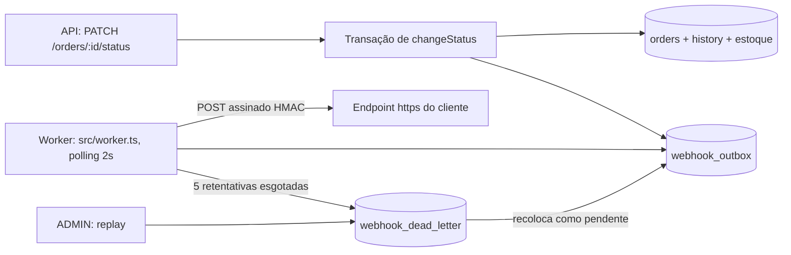

# RFC: Sistema de Webhooks de Notificação de Pedidos

| Campo | Valor |
|---|---|
| Autora | Larissa (Tech Lead) |
| Status | Em revisão |
| Data | 2026-11-17 |
| Revisores | Marcos (PM), Bruno (Eng. Pleno, Pedidos), Diego (Eng. Sênior, Plataforma), Sofia (Eng. de Segurança) |
| Origem | Reunião técnica de quinta-feira, 09:00 ([TRANSCRICAO.md](../TRANSCRICAO.md)) |
| Documentos | [PRD](PRD.md) · [FDD](FDD.md) · [ADRs](adrs/) |

## 1. Resumo executivo (TL;DR)

Propomos notificar clientes B2B por **webhooks outbound** sempre que o status de um pedido mudar. O evento é gravado numa **outbox no MySQL**, na mesma transação de `changeStatus`. Um **worker em processo separado** lê a outbox **a cada 2 segundos** e envia um POST assinado com **HMAC-SHA256**, usando uma secret por endpoint. Falhas entram em **retry com backoff exponencial** (5 retentativas, de 1 min a 12 h) e, esgotadas, vão para uma **DLQ** com replay manual por administrador. A entrega é **at-least-once**, com `X-Event-Id` para deduplicação no cliente. Tudo é feito com a stack e os padrões que o OMS já tem, sem infraestrutura nova.

## 2. Contexto e problema

Atlas Comercial, MaxDistribuição e Nova Cargo pediram notificação em tempo real das mudanças de status dos seus pedidos. Hoje eles fazem polling em `GET /orders`, o que deixa a integração lenta e cara. A Atlas sinalizou que pode migrar para um concorrente se a entrega não acontecer até o fim do trimestre ([09:00] Marcos). Para esses clientes, "tempo real" é qualquer coisa abaixo de 10 segundos ([09:02] Marcos).

O OMS não tem nenhum mecanismo de notificação externa, evento ou fila. A mudança de status vive numa transação já pesada em `src/modules/orders/order.service.ts`: atualiza o pedido, grava o histórico e mexe no estoque ([09:04] Bruno). Qualquer solução precisa preservar essa transação, porque não é aceitável a mudança de status depender da disponibilidade do cliente.

## 3. Proposta técnica

`[RFC-PROP-01]` **Captura transacional.** `changeStatus` chama `publishWebhookEvent(tx, ...)` dentro da transação existente. Só se gera evento para os endpoints ativos do cliente que assinam o status de destino; o filtro acontece na inserção ([09:34] Bruno). O payload é gravado já renderizado, como snapshot do momento da mudança. Ver [ADR-001](adrs/ADR-001-outbox-no-mysql.md) e [ADR-007](adrs/ADR-007-snapshot-de-payload-na-insercao.md).

`[RFC-PROP-02]` **Entrega assíncrona.** Um único worker, em processo próprio e com `PrismaClient` próprio, processa os eventos em ordem de criação. A ordem vale por pedido enquanto houver um só worker. Ver [ADR-002](adrs/ADR-002-worker-em-processo-separado.md).

`[RFC-PROP-03]` **Resiliência.** Timeout de 10 segundos por envio, backoff de 1 min / 5 min / 30 min / 2 h / 12 h, DLQ em tabela separada e replay manual restrito a `ADMIN`. Ver [ADR-003](adrs/ADR-003-retry-backoff-e-dlq.md).

`[RFC-PROP-04]` **Segurança.** URL só `https`, HMAC-SHA256 do corpo com secret por endpoint, rotação com 24 horas de convivência entre a secret antiga e a nova. Ver [ADR-004](adrs/ADR-004-hmac-sha256-secret-por-endpoint.md).

`[RFC-PROP-05]` **Semântica de entrega.** At-least-once, com `X-Event-Id` estável entre retentativas. Ver [ADR-005](adrs/ADR-005-at-least-once-com-x-event-id.md).

`[RFC-PROP-06]` **Superfície de API.** CRUD de configuração de webhooks, rotação de secret, histórico de entregas por webhook e replay de DLQ. Todos ficam em `src/modules/webhooks` e seguem os padrões do projeto: `AppError` com prefixo `WEBHOOK_`, Pino, `errorMiddleware`, Zod e `requireRole`. Ver [ADR-006](adrs/ADR-006-reuso-dos-padroes-do-projeto.md). Contratos, tabelas e fluxos detalhados estão no [FDD](FDD.md).

## 4. Alternativas consideradas

| ID | Alternativa | Por que foi descartada | Onde |
|---|---|---|---|
| `[RFC-ALT-01]` | Disparo HTTP síncrono dentro de `changeStatus` | Um cliente lento trava a mudança de status de outros pedidos, e um cliente fora do ar não tem tratamento possível, já que não se faz rollback de status por falha de notificação. | [09:04] Bruno, [09:06] Diego |
| `[RFC-ALT-02]` | Redis Streams ou fila dedicada | Exige subir infraestrutura nova (Redis Cluster); overengineering para um time pequeno quando o MySQL existente resolve. | [09:07] Larissa, [09:07] Diego |
| `[RFC-ALT-03]` | Trigger do MySQL para acordar o worker | O MySQL não tem `LISTEN/NOTIFY`; a trigger não avisa processo externo, e qualquer contorno seria improvisado. O polling de 2 s já atende o limite de 10 s. | [09:09] Bruno, [09:09] Diego |
| `[RFC-ALT-04]` | 3 retentativas, ou retry indefinido | 3 retentativas esgotam em cerca de 30 minutos, menos que uma manutenção planejada de 2 h já vista. O retry indefinido deixa evento pendurado para sempre. | [09:15] Diego, [09:16] Diego |
| `[RFC-ALT-05]` | Secret global da plataforma | O vazamento de uma secret exporia todos os clientes. | [09:21] Sofia |
| `[RFC-ALT-06]` | Exactly-once | Exige coordenação dos dois lados e é muito mais complexo; at-least-once com `event_id` é o padrão de Stripe e GitHub. | [09:25] Diego |
| `[RFC-ALT-07]` | Renderizar o payload só no envio | O evento passaria a descrever o pedido no momento do envio, e não no momento da mudança. | [09:52] Larissa |

## 5. Questões em aberto

1. `[RFC-OPEN-01]` **Rate limiting de envio por cliente.** Um cliente com 50 pedidos mudando de status em um minuto recebe 50 chamadas. Ficou fora do escopo, com a decisão de "observar e decidir depois" ([09:38] Diego, [09:39] Diego, [09:39] Larissa). A volumetria por cliente passa a ser acompanhada pelos logs do worker (ver [FDD](FDD.md#10-observabilidade)).
2. `[RFC-OPEN-02]` **Endurecimento de permissões do CRUD de webhooks.** Por enquanto, qualquer usuário autenticado gerencia webhooks de qualquer cliente; só o replay exige `ADMIN`. Sofia indicou que isso pode ser endurecido mais à frente ([09:36] Marcos, [09:37] Sofia).
3. `[RFC-OPEN-03]` **Escala para mais de um worker.** O desenho supõe um worker. Escalar exige particionar por `order_id` ou usar lock pessimista, tratado como "problema do futuro" ([09:13] Bruno, [09:13] Diego).
4. `[RFC-OPEN-04]` **Aviso ao cliente quando o webhook falha repetidamente.** E-mail após falhas seguidas fica para uma próxima fase, depois de medir o impacto ([09:37] Marcos, [09:37] Larissa).
5. `[RFC-OPEN-05]` **Arquivamento das linhas entregues da outbox.** Mencionado como algo em torno de 30 dias, fora do escopo desta feature ([09:08] Diego).

## 6. Impacto e riscos

**Impacto no sistema existente**

- `changeStatus` ganha um passo a mais na transação. Se esse passo falhar, a mudança de status falha junto ([09:40] Bruno).
- Quatro tabelas novas no MySQL e uma nova entry-point (`src/worker.ts`), executada como processo próprio no deploy ([09:11] Diego).
- Nenhuma alteração de contrato nos endpoints de pedidos.

**Riscos**

| ID | Risco | Mitigação |
|---|---|---|
| `[RFC-RISCO-01]` | Cliente indisponível por horas | Backoff até cerca de 15 h e DLQ com replay ([ADR-003](adrs/ADR-003-retry-backoff-e-dlq.md)). |
| `[RFC-RISCO-02]` | Vazamento de secret pelo cliente | Secret por endpoint e rotação com 24 h de convivência ([ADR-004](adrs/ADR-004-hmac-sha256-secret-por-endpoint.md)); já ocorreu antes ([09:22] Diego). |
| `[RFC-RISCO-03]` | Cliente processa evento duplicado | `X-Event-Id` e documentação destacada no portal ([09:26] Marcos). |
| `[RFC-RISCO-04]` | Crescimento da outbox | Índices em `status` e `created_at`, leitura em lote pequeno ([09:08] Diego). |
| `[RFC-RISCO-05]` | Rajada de eventos para um cliente | Questão em aberto 1: observar antes de limitar. |
| `[RFC-RISCO-06]` | Prazo: Atlas quer até o fim de novembro | Estimativa de três sprints, com dois dias úteis de revisão de segurança antes do deploy ([09:46] Larissa, [09:46] Sofia). |

## 7. Decisões relacionadas

- [ADR-001: Padrão Outbox no MySQL existente](adrs/ADR-001-outbox-no-mysql.md)
- [ADR-002: Worker em processo separado, com polling de 2 segundos](adrs/ADR-002-worker-em-processo-separado.md)
- [ADR-003: Retry com backoff exponencial e DLQ em tabela separada](adrs/ADR-003-retry-backoff-e-dlq.md)
- [ADR-004: Assinatura HMAC-SHA256 com secret por endpoint e rotação](adrs/ADR-004-hmac-sha256-secret-por-endpoint.md)
- [ADR-005: Garantia at-least-once com deduplicação por `X-Event-Id`](adrs/ADR-005-at-least-once-com-x-event-id.md)
- [ADR-006: Reuso dos padrões existentes do projeto](adrs/ADR-006-reuso-dos-padroes-do-projeto.md)
- [ADR-007: Payload renderizado (snapshot) na inserção da outbox](adrs/ADR-007-snapshot-de-payload-na-insercao.md)
